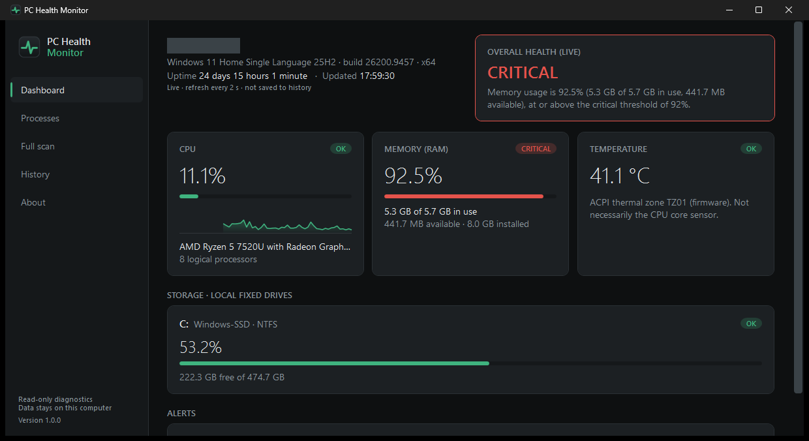
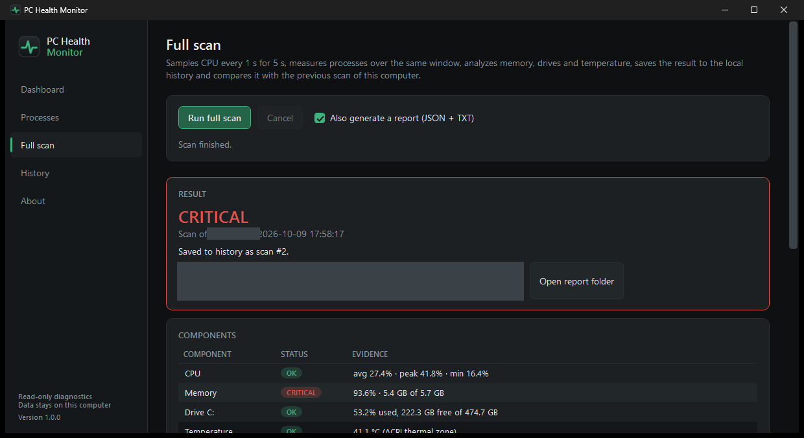

# PC Health Monitor

Aplicativo para Windows 10/11 que mostra, em uma janela simples, **como está a saúde do computador**: uso de CPU, memória RAM, espaço em disco, temperatura (quando o Windows informa), processos que mais consomem recursos e o histórico de verificações.

É uma ferramenta de **diagnóstico somente leitura**: não altera configurações, não encerra processos, não apaga arquivos e não pede privilégios de administrador.



> O nome do computador e caminhos pessoais foram ocultados nas capturas de tela. Os valores mostrados são medições reais da máquina de teste (por isso a memória aparece como crítica).

---

## Baixar e usar (sem instalar nada)

1. Abra a página **[Releases](https://github.com/kelvinsg218/pc-health-monitor/releases/latest)** deste repositório.
2. Em **Assets**, baixe **`PCHealthMonitor-1.1.0-win-x64.exe`**.
3. Dê **dois cliques** no arquivo baixado.

Não é preciso instalar .NET, Python, Node.js nem qualquer outra ferramenta: tudo o que o programa precisa está dentro do `.exe`. Não há instalador; para "desinstalar", basta apagar o arquivo (veja [Seus dados](#seus-dados)).

### Aviso do Windows SmartScreen

Como o executável **não possui assinatura digital** (certificado de código pago), o Windows pode mostrar *"O Windows protegeu o computador"* na primeira execução. Para abrir mesmo assim: **Mais informações → Executar assim mesmo**.

Se quiser conferir que o arquivo é exatamente o publicado, compare o SHA-256 com o arquivo `SHA256SUMS-1.1.0.txt` da Release:

```powershell
Get-FileHash .\PCHealthMonitor-1.1.0-win-x64.exe -Algorithm SHA256
```

### Requisitos mínimos

| Item | Requisito |
|---|---|
| Sistema | Windows 10 ou Windows 11, **64 bits (x64)** |
| Permissões | Usuário comum (não precisa de administrador) |
| Espaço | ~150 MB para o `.exe` + alguns MB para histórico/relatórios |
| Memória | ~180 MB de RAM em uso (medido) |
| Internet | Não é necessária |

Windows em ARM64 e 32 bits não são suportados por este executável.

---

## Funcionalidades

### Aplicativo (janela gráfica)

| Tela | O que mostra |
|---|---|
| **Dashboard** | Atualização ao vivo a cada 2 s: CPU (com gráfico dos últimos 2 minutos), memória RAM, cada disco local, temperatura, saúde geral **HEALTHY / ATTENTION / CRITICAL**, alertas e observações. Nada aqui é salvo no histórico. |
| **Processes** | Os 10 processos que mais usam memória e CPU (somente leitura). |
| **Full scan** | Diagnóstico completo (amostras de CPU por 5 s, processos, memória, discos, temperatura), salvo no histórico, comparado com o scan anterior e, opcionalmente, exportado como relatório **JSON + TXT**. |
| **History** | Lista dos scans salvos, detalhes de cada um e a mudança observada em relação ao scan anterior (em pontos percentuais). |
| **About** | Versão, limites (thresholds), onde os dados ficam e limitações conhecidas. |



Cada componente recebe um estado:

| Estado | Significado |
|---|---|
| **OK** | Abaixo do limite de alerta |
| **WARNING** | Igual ou acima do limite de alerta |
| **CRITICAL** | Igual ou acima do limite crítico |
| **UNKNOWN** | A métrica não pôde ser lida neste computador (o app informa, nunca inventa valor) |

Saúde geral: algum componente **CRITICAL** → CRITICAL; senão algum **WARNING** → ATTENTION; senão HEALTHY. **UNKNOWN nunca piora o resultado sozinho.**

Limites padrão: CPU 75% / 90%, memória 80% / 92%, disco 80% / 90%, temperatura (zona ACPI) 85 °C / 95 °C.

### Linha de comando (opcional)

Para técnicos que preferem terminal ou scripts, a Release também traz `pchealth-1.1.0-win-x64.exe` com os comandos `status`, `scan`, `monitor`, `processes`, `report`, `history` e `version`. Veja [CLI](#cli).

---

## Seus dados

- **Nada é enviado pela internet.** Não há telemetria.
- O app grava apenas na pasta do seu usuário:
  `%LOCALAPPDATA%\PCHealthMonitor\` → `data\pchealth.db` (histórico), `reports\` (relatórios) e `logs\` (registro técnico de erros).
- Nada é gravado ao lado do `.exe`, nada é instalado e o app **não inicia com o Windows**.
- Para remover tudo: feche o app, apague o `.exe` e a pasta `%LOCALAPPDATA%\PCHealthMonitor`.
- Na primeira execução, o .NET extrai as bibliotecas nativas embutidas no `.exe` (WPF e SQLite, ≈10 MB) para `%TEMP%\.net\PCHealthMonitor-1.1.0-win-x64\`. É o comportamento padrão de executáveis .NET de arquivo único; essa pasta pode ser apagada com o app fechado (é recriada quando necessário).
- Uso portátil (ex.: pendrive): `PCHealthMonitor-1.1.0-win-x64.exe --data-dir D:\PCHealthData` grava tudo na pasta indicada.

Coleta apenas o necessário para o diagnóstico: métricas de hardware/sistema, nome do computador e, dos processos, somente PID, nome, memória e tempo de CPU. Não lê arquivos pessoais, navegador, senhas, área de transferência, teclado, tela ou linhas de comando.

## Segurança

- Somente leitura: não altera Registro, serviços, políticas, Defender, Firewall ou atualizações; não encerra nem modifica processos; não apaga arquivos do sistema.
- Executa como usuário comum (`asInvoker` no manifesto) e nunca solicita elevação. Métricas que exigiriam administrador aparecem como **Unavailable**.
- As únicas ações externas são, quando você clica, abrir uma pasta no Explorer.
- Construído só com componentes da Microsoft/.NET (WPF, EF Core, SQLite via Microsoft.Data.Sqlite, System.Management); nenhum driver ou biblioteca de terceiros para leitura de sensores.
- Ao fechar a janela, o monitoramento em segundo plano e qualquer scan em andamento são interrompidos e o processo termina (verificado: nenhum processo residual).

## Limitações conhecidas

- **Temperatura:** vem apenas das zonas térmicas ACPI que o firmware expõe ao Windows. Uma zona ACPI **não é necessariamente o sensor do núcleo da CPU**, e muitos computadores não expõem nenhuma — nesse caso aparece *Unavailable*. A leitura via `MSAcpi_ThermalZoneTemperature` exige administrador e não é usada.
- **CPU:** o valor é baseado em tempo de processador; o Gerenciador de Tarefas mostra "utilidade do processador" (considera frequência/turbo), então os números podem diferir um pouco.
- **Memória por processo:** é o *working set* (inclui páginas compartilhadas); o Gerenciador de Tarefas mostra, por padrão, o *working set privado*.
- **Não avaliado nesta versão:** saúde física dos discos (SMART), GPU, bateria, rede e eventos do Windows.
- **Executável não assinado:** pode acionar o SmartScreen (ver acima).
- **Testado em uma única máquina** (Windows 11 Home 25H2, x64, sem privilégios de administrador). Não há evidência de testes em outras máquinas ou no Windows 10 até o momento.

---

## Desenvolvimento

### Tecnologias

| Item | Uso |
|---|---|
| C# / .NET 8 (LTS) | Alvo `net8.0` / `net8.0-windows` |
| WPF | Interface gráfica (parte do .NET, sem bibliotecas de UI de terceiros) |
| EF Core 8 + SQLite | Histórico local |
| System.Management | Leitura WMI da zona térmica (sem `WMIC.exe`) |
| Microsoft.Extensions.Configuration/Logging | Configuração opcional e log em arquivo |
| xUnit | Testes |

### Estrutura

```
src/
  PCHealthMonitor.Domain/          estados, métricas, regras de classificação
  PCHealthMonitor.Application/     coletores (abstrações), HealthAnalyzer, scan, monitor, histórico, relatórios
  PCHealthMonitor.Infrastructure/  coletores Windows, SQLite/EF Core, relatórios, logs, composição
  PCHealthMonitor.Desktop/         aplicativo WPF (PCHealthMonitor.exe)
  PCHealthMonitor.Cli/             ferramenta de linha de comando (pchealth.exe)
tests/PCHealthMonitor.Tests/       testes automatizados
build/publish.ps1                  build reprodutível da Release
tools/IconGenerator/               gera o ícone (Assets/app.ico)
docs/screenshots/                  capturas usadas neste README
```

Desktop e CLI compartilham as mesmas camadas: o dashboard ao vivo usa o mesmo `HealthAnalyzer` do scan, e nenhuma regra de diagnóstico fica na interface.

### Executar a partir do código

Requer Windows 10/11 x64 e o .NET SDK 8 ou mais novo.

```powershell
dotnet build
dotnet run --project ./src/PCHealthMonitor.Desktop          # aplicativo
dotnet run --project ./src/PCHealthMonitor.Cli -- status    # CLI
dotnet test
```

### Gerar o executável (build da Release)

```powershell
powershell -ExecutionPolicy Bypass -File build/publish.ps1 -IncludeCli
```

O script:

1. restaura pacotes e roda os testes;
2. publica o desktop com o perfil `src/PCHealthMonitor.Desktop/Properties/PublishProfiles/win-x64.pubxml` (**self-contained**, **arquivo único**, win-x64);
3. grava em `dist/`:
   - `PCHealthMonitor-<versão>-win-x64.exe`
   - `pchealth-<versão>-win-x64.exe` (com `-IncludeCli`)
   - `SHA256SUMS-<versão>.txt`

`dist/` e `artifacts/` são ignorados pelo Git; os executáveis são distribuídos pela página de Releases.

Opções: `-Version 1.1.0` (sobrescreve a versão), `-SkipTests`, `-IncludeCli`. Na primeira execução o SDK baixa do NuGet os runtime packs do .NET 8.

Decisão de empacotamento: o `.exe` **não usa compressão** de arquivo único. Comprimido ele teria ~66 MB, mas todos os assemblies seriam descompactados na RAM (~316 MB de working set medidos); sem compressão (~147 MB) eles são mapeados do arquivo e o app usa ~180 MB — mais adequado para uma ferramenta usada em máquinas com pouca memória.

### Nova versão

1. Atualize `<Version>` em `Directory.Build.props` (ex.: `1.1.0`).
2. Rode `build/publish.ps1 -IncludeCli`.
3. Faça commit, crie a tag `v1.1.0` e publique uma Release anexando os arquivos de `dist/`.

### Ícone

O ícone é desenhado por código. Para regenerá-lo:

```powershell
dotnet run --project tools/IconGenerator -- src/PCHealthMonitor.Desktop/Assets
```

### Configuração opcional

O app funciona sem configuração. Para mudar limites ou intervalos, coloque um `appsettings.json` **ao lado do `.exe`** (mesmo formato de `src/PCHealthMonitor.Cli/appsettings.json`), por exemplo:

```json
{ "PcHealth": { "Thresholds": { "MemoryWarning": 85, "MemoryCritical": 95 }, "Monitor": { "RefreshIntervalSeconds": 3 } } }
```

Valores inválidos (ex.: alerta maior que crítico) não impedem a abertura: o app usa os padrões e mostra um aviso explicando o problema.

---

## CLI

```powershell
pchealth status        # diagnóstico rápido
pchealth scan          # diagnóstico completo, salvo no histórico
pchealth monitor       # visão ao vivo (Ctrl+C para sair; nunca salva)
pchealth processes     # top processos por memória e CPU
pchealth report        # scan completo + relatório JSON/TXT em reports/
pchealth history       # histórico; history show <id>; history compare [<id> <id>]
pchealth --help
```

Opções: `scan --duration <s> --interval <s> --top <n> --report --no-save`, `monitor --refresh <s> --count <n>`, `processes --top <n> --sample <s>`, `history --limit <n>`, global `--no-color`.
Códigos de saída: `0` sucesso, `1` erro de execução, `2` uso/configuração inválidos, `130` cancelado.
A CLI grava `data/`, `reports/` e `logs/` no **diretório atual** (configurável em `Paths`).

Durante o desenvolvimento: `dotnet run --project ./src/PCHealthMonitor.Cli -- <comando>`.

---

## Como as métricas são obtidas

| Métrica | Fonte (somente leitura) |
|---|---|
| CPU total | `GetSystemTimes` — amostras ao longo de uma janela; scan calcula mínimo, pico e média |
| Memória | `GlobalMemoryStatusEx` (+ RAM instalada via `GetPhysicallyInstalledSystemMemory`) |
| Discos | `DriveInfo`, apenas discos fixos locais (unidades ópticas, removíveis e de rede são ignoradas) |
| Processos | Lista de processos do sistema (`NtQuerySystemInformation`, a mesma do Gerenciador de Tarefas): CPU de **todos** os processos sem precisar de administrador |
| Temperatura | Contador "Thermal Zone Information" via WMI (`Win32_PerfRawData_Counters_ThermalZoneInformation`); valores implausíveis são descartados |
| Sistema | Registro (`CurrentVersion`) — Windows 10/11 decidido pelo **número do build**, porque o `ProductName` diz "Windows 10" mesmo no Windows 11 |
| Uptime | `GetTickCount64` |

O SQLite guarda apenas scans completos (tabelas `Scans`, `ScanDrives`, `ScanMessages`, criadas por migrations do EF Core na primeira utilização), com retenção padrão de 365 dias. O relatório JSON (`pchealth_HOST_AAAA-MM-DD_HHMMSS.json`) inclui sistema, CPU, memória, discos, temperatura (ou `null`), uptime, resumo de processos, estados, saúde geral, mensagens e limites usados.

## Testes

```powershell
dotnet test                                            # 186 testes
dotnet test --filter "Category!=WindowsIntegration"    # apenas os independentes da máquina
```

Cobrem o `HealthAnalyzer` (limites exatos, UNKNOWN, saúde geral), configuração e validação, amostragem de CPU, cálculo de CPU por processo, histórico e comparação em pontos percentuais, SQLite com migrations em banco em memória, relatórios JSON/TXT, monitor (cancelamento, não persistência), a projeção ao vivo usada pelo dashboard, mapeamentos das telas, parser da CLI e 6 testes de integração somente leitura com os coletores reais do Windows.

Validações manuais realizadas no executável final (Windows 11 Home 25H2, x64, usuário sem administrador, tela 1366×768): abertura sem argumentos e em pasta limpa contendo apenas o `.exe`; nenhum módulo carregado da instalação local do .NET (runtime embutido); subsistema GUI (sem console); navegação por todas as telas e scan via UI Automation; interface respondendo em ≤ 65 ms durante scans; CPU do próprio app de 0,04–0,24% em regime estável; fechamento sem processos residuais; `appsettings.json` inválido tratado com aviso.

## Roadmap

Possibilidades futuras (não implementadas): assinatura digital do executável, gráficos de histórico, alertas/notificações, monitoramento remoto e centralizado, inventário de vários computadores, integração com o **Windows Maintenance Agent**, saúde física de discos (SMART) e bateria.
